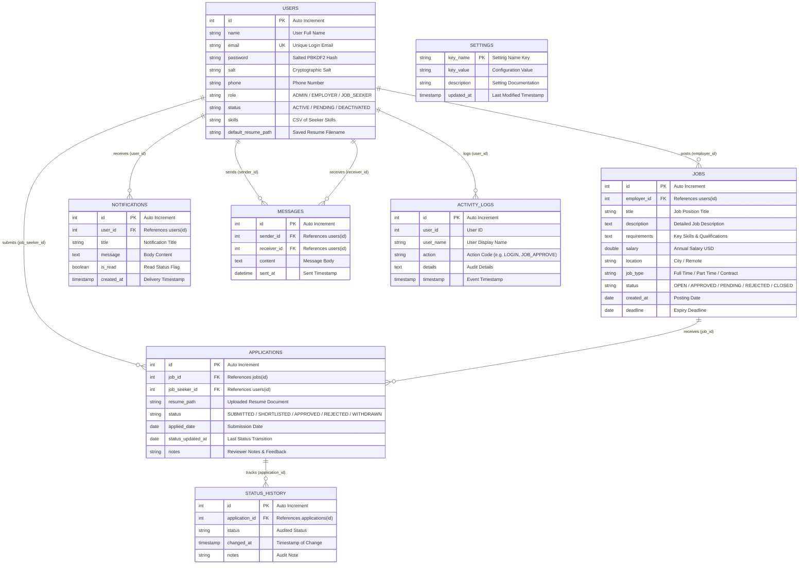

# Entity Relationship (ER) Diagram

Below is the complete database schema for the **JobSphere - Online Job Portal** system, detailing all primary keys, foreign keys, relationships, and data attributes.

### Table Indexes for Query Optimization
- `idx_users_email` on `users(email)`
- `idx_jobs_status` on `jobs(status)`
- `idx_jobs_employer` on `jobs(employer_id)`
- `idx_applications_job` on `applications(job_id)`
- `idx_applications_seeker` on `applications(job_seeker_id)`
- `idx_notifications_user` on `notifications(user_id)`
