# UML Class Diagram (Architecture & OOP Design)

Below is the UML Class Diagram illustrating inheritance, interfaces, polymorphism, DAO abstraction, service orchestration, and multithreading components.

```mermaid
classDiagram
    %% Inheritance Hierarchy & Polymorphism
    class User {
        <<abstract>>
        #int id
        #String name
        #String email
        #String password
        #String salt
        #String phone
        #String status
        #String skills
        #String defaultResumePath
        +abstract void showDashboard()
        +getRoleEnum() Role
        +equals(Object) boolean
        +hashCode() int
    }

    class Admin {
        +showDashboard()
        +manageUsers()
        +approveJob(int jobId)
    }

    class Employer {
        +showDashboard()
        +postJob(Job job)
        +reviewApplications()
    }

    class JobSeeker {
        +showDashboard()
        +applyJob(Job job)
        +uploadResume(String path)
    }

    User <|-- Admin
    User <|-- Employer
    User <|-- JobSeeker

    %% Entities
    class Job {
        -int id
        -int employerId
        -String title
        -String description
        -String requirements
        -double salary
        -String location
        -String jobType
        -String status
        -LocalDate createdAt
        -LocalDate deadline
        +isActive() boolean
        +isExpired() boolean
        +compareTo(Job) int
        +equals(Object) boolean
        +hashCode() int
    }

    class Application {
        -int id
        -int jobId
        -int jobSeekerId
        -String resumePath
        -String status
        -LocalDate appliedDate
        -LocalDate statusUpdatedAt
        -String notes
        +getStatusEnum() ApplicationStatus
        +equals(Object) boolean
        +hashCode() int
    }

    %% Generic DAO Interface
    class DAO~T~ {
        <<interface>>
        +save(T t) void
        +findById(int id) Optional~T~
        +findAll() List~T~
        +update(T t) void
        +delete(int id) void
    }

    class UserDAO {
        +findByEmail(String email) Optional~User~
        +seedInitialUsers() void
    }

    class JobDAO {
        +findByEmployerId(int employerId) List~Job~
        +searchJobs(String kw, String loc, String type) List~Job~
    }

    class ApplicationDAO {
        +saveWithTransaction(Application app, String note, int employerId) boolean
        +findByJobSeekerId(int seekerId) List~Application~
        +updateStatus(int id, String status, String note) void
    }

    DAO <|.. UserDAO
    DAO <|.. JobDAO
    DAO <|.. ApplicationDAO

    %% Services
    class UserService {
        +authenticate(String email, String pass) Optional~User~
        +register(User user) boolean
    }

    class JobService {
        +postJob(Job job) void
        +searchJobs(String kw, String loc, String type, Double minSal, int page, int size) List~Job~
    }

    class ApplicationService {
        +applyForJob(int jobId, int seekerId, String resume, String name) Application
        +withdrawApplication(int appId, int seekerId) void
        +groupApplicationsByStatus() Map~String, List~Application~~
    }

    %% Concurrency & Multithreading
    class ThreadManager {
        -ExecutorService executorService
        -ScheduledExecutorService scheduledExecutor
        -AtomicInteger activeTasksCount
        +executeTask(Runnable) void
        +submitTask(Callable~T~) Future~T~
        +schedulePeriodicTask(Runnable, long, long, TimeUnit) ScheduledFuture
        +shutdown() void
    }

    class ActivityLogger {
        -BlockingQueue~ActivityLog~ logQueue
        -Thread workerThread
        +log(int userId, String name, String action, String details) void
        +shutdown() void
    }

    ApplicationService ..> ApplicationDAO : uses
    ApplicationService ..> ThreadManager : dispatches async tasks
    ApplicationService ..> ActivityLogger : audits
    JobService ..> JobDAO : uses
    UserService ..> UserDAO : uses
```

### Key OOP Principles Demonstrated
1. **Inheritance & Polymorphism**: Abstract base class `User` extended by `Admin`, `Employer`, and `JobSeeker`, overriding `showDashboard()` with dynamic runtime dispatch.
2. **Interfaces & Generics**: Interface `DAO<T>` generic repository pattern implemented across database DAOs.
3. **Collections & Comparable**: `Job` implements `Comparable<Job>` providing natural chronological sorting order.
4. **Encapsulation**: Fully encapsulated private/protected fields with strongly-typed getters, setters, and Domain Enums (`Role`, `JobStatus`, `ApplicationStatus`).
